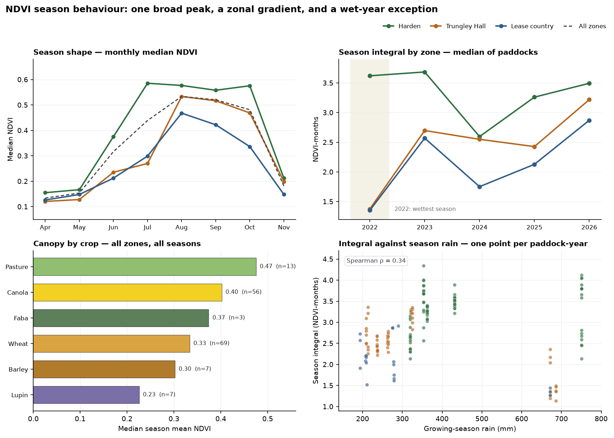

# Five seasons of a mixed farming operation

This is the data-analysis section for assignment 2. It asks three questions of
the committed example tables: what the paddock panel and rotation say, what the
climate record says, and how the NDVI season behaves. Soil profiles and
boundary diagnostics are deliberately out of scope — they belong to the
pipeline's own outputs, not to a field-year analysis.

Every number below is computed by `src/build_analysis.py` from
`examples/panel_field_year.csv`, `examples/rotation_spine.csv`,
`examples/weather_seasonal.csv`, `examples/ndvi_field_year.csv` and
`examples/ndvi_monthly.csv`. The prose lives in `src/analysis_template.md` and
the builder substitutes each computed value into it; it fails if a template
token has no computation behind it, and fails if a computed finding is never
printed. So the sentences and the tables cannot drift apart, and
`python src/build_analysis.py --check` is the drift test.

A one-page summary of the same findings, with the five figures embedded, is
[eda_report.html](eda_report.html). It is generated from the same computed
dictionary by `src/build_report.py`.

## The short version

- **33 paddocks over 5 seasons, but a very uneven
  operation.** 6 of the 33 paddocks carry
  63.4 % of the 2,972.4 ha footprint;
  16 carry 13.0 %.
- **A two-crop rotation.** Wheat and canola fill 80.6 % of the
  155 paddock-years with a crop, and canola is the break: canola to
  wheat is 36.1 % of all consecutive-year transitions.
- **A west–east gradient that outlives any single season.** Harden averages
  443 mm of growing-season rain and a median season NDVI of
  0.417; lease country averages 326 mm and 0.266.
- **2022 is the season that carries the most information.** It was the
  wettest (688 mm) and produced one of Harden's best canopies (median
  season integral 3.621) alongside the weakest on Trungley
  Hall and lease country (1.376 and
  1.353).
- **Coverage is good and reported honestly.** 1,209 of
  1,240 managed paddock-months have an observation
  (2.5 % missing), and the 31 gaps are named rather than
  interpolated.



## What this data can and cannot say

Read these first; several limits change how a sentence should be read.

- **Five seasons is five points.** The climate tables hold 5
  seasons and 30 farm-seasons. Any correlation here is
  descriptive, with an effective sample closer to 30 than to
  155, because paddocks on one farm share one climate record.
- **There is no yield, price or input data in the repository.** NDVI is canopy
  greenness, not production. Nothing below supports a statement about
  profitability, and "good season" always means "green canopy", never
  "profitable season".
- **A crop record is a paddock-level declaration.** 9
  paddock-years are split between two crops; the panel assigns the majority
  crop, so rotation shares describe paddocks rather than areas within them.
- **"Not managed" means no crop was recorded, not that the land was bare.**
  10 paddock-years carry no crop: 7 are the opening
  seasons of the two older lease blocks, and 3 are Rio paddocks in
  2026. NDVI exists for those years and is not uniform — the opening
  lease seasons sit between 0.176 and 0.338 mean
  NDVI, while Rio's 2026 paddocks sit between 0.369 and
  0.397, a full canopy with no record attached. They are excluded
  from every crop statistic rather than treated as fallow.
- **One scene per month.** The NDVI stage keeps the candidate with the most
  visible paddock pixels per month, so within-month events — a frost, a
  waterlogging spell, a grazing pass — are invisible. The month is the finest
  resolution here.
- **Gaps cluster at the end of the season.** Of the 31 missing
  paddock-months, 20 are November and 6 are June;
  28 of 155 seasons are incomplete rather than
  absent.

## 1. The panel: 33 paddocks, three very different scales

The panel is 33 paddocks on 6 farms in 3 zones,
165 paddock-years from 2022 to 2026.
155 paddock-years have a crop and 10 do not. The
footprint totals 2,972.4 ha: 2,905.5 ha cropped in
2025 and 67 ha of non-cropped area, and
the two add to the footprint. "Area" below always means cropped area unless it
says footprint.


| Zone          | Farms | Paddocks | Footprint ha | Area share % | Observed field-years | Not managed |
| ------------- | ----: | -------: | -----------: | -----------: | -------------------: | ----------: |
| Harden        |     1 |       16 |        386.2 |         13.0 |                   80 |           0 |
| Trungley Hall |     2 |       11 |        701.0 |         23.6 |                   55 |           0 |
| Lease country |     3 |        6 |      1,885.2 |         63.4 |                   20 |          10 |
| All           |     6 |       33 |      2,972.4 |        100.0 |                  155 |          10 |


The zone table is the first warning against averaging paddocks. Lease country
holds 18.2 % of the paddocks but 63.4 % of the
area; Harden holds 48.5 % of the paddocks and
13.0 % of the area. Median paddock size runs
23.6 ha at Harden, 58.5 ha at Trungley Hall
and 351.7 ha on the lease blocks — a 15-fold range.
An unweighted paddock mean therefore over-weights Harden, and an area-weighted
statement over-weights the 6 lease paddocks. Both are reported
where they differ.


| Season | Paddocks with a crop | Not managed | Cropped ha | Paddock-months observed |
| ------ | -------------------: | ----------: | ---------: | ----------------------: |
| 2022   |                   30 |           3 |      1,929 |                     223 |
| 2023   |                   30 |           3 |      1,929 |                     233 |
| 2024   |                   32 |           1 |      2,578 |                     250 |
| 2025   |                   33 |           0 |      2,905 |                     263 |
| 2026   |                   30 |           3 |      2,067 |                     240 |


Managed area is not stable across the five seasons: 1,929 ha in
2022 and 2023, then growth as the lease blocks enter, peaking
at 2,905 ha in 2025, and 2,067 ha in
2026 when the Rio paddocks have no crop record. A year-on-year change
in crop shares therefore partly reflects *which paddocks were farmed*, not a
decision on the same land. That is why the rotation section works from
transitions within a paddock rather than from year totals.

## 2. Rotation: canola is the break, and it sets the wheat area

Across the 122 consecutive-year transitions where both years have
a crop, two moves dominate:


| Transition                  | Field-years | Share % |
| --------------------------- | ----------: | ------: |
| Canola to Wheat             |          44 |    36.1 |
| Wheat to Canola             |          32 |    26.2 |
| Wheat to Wheat              |          11 |     9.0 |
| Wheat to Barley             |           7 |     5.7 |
| Narrow Leaf Lupin to Canola |           6 |     4.9 |
| Pasture to Canola           |           6 |     4.9 |
| All other transitions       |          16 |    13.1 |


Canola to wheat (36.1 %) and wheat to canola
(26.2 %) account for most of the sequence. Same-crop repeats
are 15.6 % of transitions and wheat-after-wheat specifically
9.0 %, so continuous wheat is the exception rather than the
system. Over the whole panel wheat is 44.5 % of cropped paddock-years
and canola 36.1 %; by crop group that is 49.0 % cereal,
36.1 % oilseed, 6.5 % legume and 8.4 %
pasture. This is a two-crop rotation with a legume and pasture fringe, not a
diverse break-crop system.


| Crop                  | Harden | Trungley Hall | Lease country |  All |
| --------------------- | -----: | ------------: | ------------: | ---: |
| Wheat                 |   42.5 |          45.5 |          50.0 | 44.5 |
| Canola                |   41.2 |          29.1 |          35.0 | 36.1 |
| Barley                |    0.0 |          10.9 |           5.0 |  4.5 |
| Narrow Leaf Lupin     |    0.0 |           9.1 |          10.0 |  4.5 |
| Faba/Broad/Field Bean |    0.0 |           5.5 |           0.0 |  1.9 |
| Pasture               |   16.2 |           0.0 |           0.0 |  8.4 |


The zones differ in more than scale. Harden carries every pasture
paddock-year and no barley or lupin at all. Trungley Hall is the most mixed:
barley, lupin and faba beans all appear.
Lease country has no pasture and no faba beans. Shannon diversity over crops
reflects that mix — Trungley Hall 1.34, Harden
1.02, lease country 1.09 — but the lease figure
rests on 20 cropped paddock-years against
80 at Harden, so it is the least reliable of the
three.


| Crop          | 2022 | 2023 | 2024 | 2025 | 2026 |
| ------------- | ---: | ---: | ---: | ---: | ---: |
| Wheat         | 33.3 | 30.0 | 68.8 | 36.4 | 53.3 |
| Canola        | 33.3 | 50.0 | 15.6 | 48.5 | 33.3 |
| Barley        |  0.0 | 10.0 |  3.1 |  9.1 |  0.0 |
| Other legumes | 10.0 |  0.0 |  9.4 |  3.0 | 10.0 |
| Pasture       | 23.3 | 10.0 |  3.1 |  3.0 |  3.3 |


The year table shows the rotation pulsing rather than averaging out.
2023 was a canola year (50.0 % of cropped paddock-years),
which pushed 2024 to 68.8 % wheat and only
15.6 % canola: 15 of 30 transitions that year ran
canola to wheat. The correction came immediately — 13 of 32
transitions from 2024 to 2025 ran wheat to canola. The canola
share in one season largely sets the wheat share in the next, so a single year's
crop mix is a poor description of the rotation.

## 3. Climate: a west–east gradient and five very different seasons

Climate comes from SILO at 0.05°, one grid point per farm, and every paddock on
a farm shares that point. The table is therefore per zone, averaged over its
farms, not per paddock. Growing seasons differ by farm — Kanoona runs to 30
November, the other farms to 15 November — and every figure below uses each
farm's own window.


| Zone          | Season rain mm | Season range mm | GDD base 0 | Frost days | Sowing rain mm |
| ------------- | -------------: | --------------: | ---------: | ---------: | -------------: |
| Harden        |            443 |         320–750 |      2,911 |         67 |            112 |
| Trungley Hall |            343 |         209–687 |      2,883 |         59 |             95 |
| Lease country |            326 |         180–688 |      2,983 |         51 |             94 |


Harden is the wetter, frostier end: 443 mm of season rain
(320–750 mm across the five seasons), 2,911 degree-days
base 0 °C and 67 frost days. Lease country is the drier, warmer
end at 326 mm (180–688), 2,983 degree-days and
51 frost days. Trungley Hall sits between on rain
(343 mm, 209–687) and frost (59
days) but has essentially the same heat sum as Harden (2,883 against
2,911 degree-days) — a reminder that GDD is set by temperature and
season length, not by rainfall. Sowing rain
follows the rain gradient: 112 mm at Harden, 95 mm
at Trungley Hall, 94 mm on the lease blocks.


| Season | Rain mm | GDD base 0 | Frost days | Sowing rain mm |
| ------ | ------: | ---------: | ---------: | -------------: |
| 2022   |     688 |      2,850 |         36 |            190 |
| 2023   |     226 |      2,885 |         73 |             61 |
| 2024   |     278 |      2,906 |         66 |            110 |
| 2025   |     244 |      2,942 |         62 |             54 |
| 2026   |     321 |      3,104 |         43 |             73 |


The seasons differ far more than the zones do. 2022 took
688 mm against 226 mm in 2023 — a
3.0-fold difference — and 2022 holds the wettest
single farm-season in the record (Kanoona, 2022,
750 mm), while the driest is Brentwood (lease) in 2023 at
180 mm. The heat sum moves the other way: 2026 is the warmest
season at 3,104 degree-days, 8.9 % above 2022
(2,850). Sowing rain separates the seasons even more sharply —
190 mm in 2022 against 54 mm in 2025,
a factor of 3.6. Mean frost days run from 36 in the wet
2022 to 73 in 2023, and every season after
2022 stayed below 320 mm — 278 mm in 2024,
244 mm in 2025 and 321 mm in 2026.

Rain and heat are not independent: the correlation between season rain and GDD
base 0 is -0.33 across the 30 farm-seasons, so drier
seasons tend to run hotter. A claim of the form "heat drove this, not rain" is
therefore not testable with five seasons, and this analysis does not make one.

One record is still open. 2026 at Kanoona covers
239 of 244 season days, because the daily record
stops short of the season end, so its totals are lower than a completed year's
and its lines stop rather than being projected. Every other farm-season is
complete.

## 4. NDVI: one broad peak, a zonal gradient, and a 2022 exception

### Coverage

The 155 managed seasons expect 1,240 paddock-months and
have 1,209, leaving 31 gaps (2.5 %). The
not-managed seasons add 77 observed months of
80, but they carry no crop and enter no crop comparison.
Gaps cluster at the end of the season — 20 of the 31 are
November, when the canopy is already senescing, and 6 are June — and
the median visible fraction of a used month is 1.000 in
every zone-year, so the months that do appear are not marginal observations.

### Season shape


| Month | Name      | Median NDVI |   P10 |   P90 |
| ----: | --------- | ----------: | ----: | ----: |
|     4 | April     |       0.134 | 0.103 | 0.250 |
|     5 | May       |       0.154 | 0.109 | 0.514 |
|     6 | June      |       0.317 | 0.119 | 0.547 |
|     7 | July      |       0.439 | 0.184 | 0.637 |
|     8 | August    |       0.534 | 0.294 | 0.658 |
|     9 | September |       0.521 | 0.317 | 0.647 |
|    10 | October   |       0.481 | 0.307 | 0.624 |
|    11 | November  |       0.182 | 0.138 | 0.347 |


The season is a single broad peak: 0.134 in April and 0.154 in
May, a rapid rise through 0.317 in June and 0.439 in July, a
maximum of 0.534 in August, a plateau through 0.521 in September
and 0.481 in October, then a fall to 0.182 in November. The August
spread is wide — 0.294 to 0.658 between the 10th and 90th
percentiles — because crops and zones peak at different times. That single rise,
plateau and senescence, with no second peak, is what one winter crop filling the
whole window looks like. The season integral over the same seasons runs from
1.139 to 4.346 NDVI-months, with a median of
2.827.

Peak timing confirms it. Across all 155 seasons the peak falls in
September 56 times, August 36, July 26 and October
26. Wheat peaks in September in 36 of 69
seasons; canola peaks in July or August in 42 of
56, earlier than wheat, as expected for an earlier oilseed.

### Crop and zone


| Crop                  | Field-years | Median mean NDVI | Median integral | Median peak |
| --------------------- | ----------: | ---------------: | --------------: | ----------: |
| Wheat                 |          69 |            0.334 |           2.644 |       0.615 |
| Canola                |          56 |            0.402 |           3.132 |       0.604 |
| Barley                |           7 |            0.302 |           2.416 |       0.542 |
| Narrow Leaf Lupin     |           7 |            0.226 |           1.519 |       0.475 |
| Faba/Broad/Field Bean |           3 |            0.374 |           2.993 |       0.638 |
| Pasture               |          13 |            0.475 |           3.800 |       0.647 |


Read the ordering carefully. Pasture leads on the mean because most of its
paddock-years carry a canopy across the whole window rather than senescing,
and lupin trails. Faba beans rest on 3 seasons and should not be
ranked. The integral ranks the crops in the same order as the mean, so the
ordering is not an artefact of how many months each season happened to observe.


| Zone          | Field-years | Median mean NDVI | Wheat only | Median integral |
| ------------- | ----------: | ---------------: | ---------: | --------------: |
| Harden        |          80 |            0.417 |      0.390 |           3.333 |
| Trungley Hall |          55 |            0.328 |      0.348 |           2.507 |
| Lease country |          20 |            0.266 |      0.266 |           2.057 |


The zone gradient is the same one the climate shows, and it narrows when the
crop mix is held constant. Across all crops the median season mean is
0.417 at Harden, 0.328 at Trungley Hall and 0.266
on lease country, and the median integral is 3.333,
2.507 and 2.057; wheat alone gives
0.390, 0.348 and 0.266. Holding the crop constant
closes part of the Trungley gap and none of the lease gap: the lease blocks also
carry lupin, the weakest crop in the panel, but that is not the whole story.

The integral tells the same thing, and the gap between Harden and lease country
(1.275 NDVI-months) is larger than the entire spread of Harden's
own best and worst seasons (2.596 to
3.686, a range of 1.089). A zone effect
here is not a proxy for a bad year.

### The 2022 exception


| Zone          |  2022 |  2023 |  2024 |  2025 |  2026 |
| ------------- | ----: | ----: | ----: | ----: | ----: |
| Harden        | 3.621 | 3.686 | 2.596 | 3.261 | 3.495 |
| Trungley Hall | 1.376 | 2.698 | 2.550 | 2.428 | 3.219 |
| Lease country | 1.353 | 2.570 | 1.752 | 2.128 | 2.871 |


This table is the central result of the section. Harden's median season integral
never drops below 2.596, but Trungley Hall and lease country
collapse in 2022 to 1.376 and
1.353 while Harden that same season records
3.621. The western blocks lost most of their season and the
eastern block did not, in the wettest year on record.

That is not a coverage artefact. The Trungley Hall wheat seasons in
2022 hold 6 to
7 of 8 months because November is
missing, and a missing November raises a season mean by about
0.024 NDVI — several times smaller than the 2022 western
deficit. Visibility is not the explanation either: the
median visible fraction of a used month is 1.000 in every
zone-year. And the collapse cuts
across crops — lease-country canola and lupin are as depressed as Trungley Hall
wheat — so it is not a crop story.

What it is cannot be settled with these tables. The obvious candidate is the
sowing window, which was the wettest of the five seasons: 171.7
mm at Kanoona against 181.7–209.8 mm
on the other five farms, with the least sowing rain where the canopy was best.
But sowing date is not recorded, so the association is where the evidence stops.

One tempting explanation has to be refused. In 2022 the
5 grain-wheat seasons average 0.195 mean NDVI and
1.364 integral, against 0.308 and
2.463 for the 5 dual-purpose seasons — which
reads like a use-type effect. But the grain seasons are exactly the paddocks in
Trungley Hall and the dual-purpose seasons exactly those in
Harden; zone and use type are perfectly confounded that year, so
the comparison attributes nothing to either.


| Season | Wheat field-years | Median mean NDVI | Median integral |
| ------ | ----------------: | ---------------: | --------------: |
| 2022   |                10 |            0.240 |           1.816 |
| 2023   |                 9 |            0.399 |           2.791 |
| 2024   |                22 |            0.305 |           2.387 |
| 2025   |                12 |            0.381 |           3.044 |
| 2026   |                16 |            0.418 |           3.342 |


Holding the crop fixed removes the mix effect but not the year effect.
2022 is the weak wheat season (0.240) and 2026 the
strongest (0.418); 2023 (0.399) and 2025
(0.381) lie in between, and the 2024 dip (0.305) is
system-wide rather than western — it is the season with the most wheat
(68.8 % of paddock-years) and only 278 mm of rain.

### Rain and canopy

Pooling all 155 seasons, the integral and season rain correlate at
0.00 Pearson and 0.34 Spearman — flat
in levels, weakly monotone in ranks. Wheat alone (rho 0.30) and
canola alone (rho 0.28) do not sharpen it.


| Season-rain tercile | Field-years | Mean rain mm | Median integral |
| ------------------- | ----------: | -----------: | --------------: |
| dry                 |          66 |          258 |           2.495 |
| mid                 |          43 |          349 |           3.279 |
| wet                 |          46 |          617 |           3.333 |


The dry third sits clearly below the others
(2.495 against 3.279 and
3.333), but the middle and wet thirds are effectively equal.
In this sample, once a season is not dry, more rain does not buy more canopy,
and 2022 — the wettest season — is the counter-example that flattens
the correlation.

### What a missing month costs

Across the 127 complete managed seasons, dropping November
raises the season mean by 0.024 NDVI — November's own median is
0.182 and its complete-season mean 0.227 — and removes
0.190 NDVI-months from the integral. A season missing November
therefore reads slightly greener on the mean and slightly shorter on the
integral. With 20 of 31 gaps in November, that is the dominant
measurement bias in this section; the integral is the more robust season metric
and it is the one used for the zone comparisons.

## 5. What the five seasons say

1. **The rotation is a two-crop pulse, not a fixed plan.** Wheat and canola are
   80.6 % of cropped paddock-years, and the canola share in
   one season sets the wheat share in the next: 15 of 30 canola to
   wheat transitions into 2024, then 13 of 32 wheat to
   canola into 2025.
2. **Paddock averages hide the operation.** Six paddocks hold
   63.4 % of the area and sixteen hold 13.0 %, so
   this document states which basis each statistic uses.
3. **The zone gradient is the largest stable signal.** Harden
   (0.417, 443 mm) leads Trungley Hall
   (0.328, 343 mm) and lease country
   (0.266, 326 mm) on the season integral in all five
   seasons, and the Harden-to-lease gap of 1.275 NDVI-months
   exceeds Harden's own seasonal range of 1.089.
4. **2022 is the informative exception.** The wettest year produced a
   near-best Harden canopy and the worst western canopy; the association with the
   sowing window is real in the data, and the mechanism is untestable without
   sowing dates.
5. **Rain is a weak predictor once the season is not dry.** Rank correlation is
   0.34 overall, and the mid and wet terciles are
   indistinguishable (3.279 against
   3.333).
6. **The measurement limits are known and bounded.** 31 of
   1,240 paddock-months are missing (2.5 %), mostly in
   November, which biases the mean up by 0.024 and the integral down
   by 0.190; nothing is imputed, and 2026 remains a
   partial season.

## Reproducing this section

From this directory, with the Python environment the repository already uses
for the EDA:

```bash
python src/export_ndvi_examples.py   # runtime -> examples/ (the only runtime step)
python src/make_figures.py --only 5  # examples/figures/fig05_ndvi_season.png
python src/build_analysis.py         # writes ANALYSIS.md
python src/build_analysis.py --check # fails if ANALYSIS.md is stale
```

`export_ndvi_examples.py` is the bridge from the untracked runtime tree to the
committed tables; every step after it reads only `examples/`. `build_analysis.py`
needs pandas and numpy, not the geospatial stack, and runs offline.
